<p align="center">
  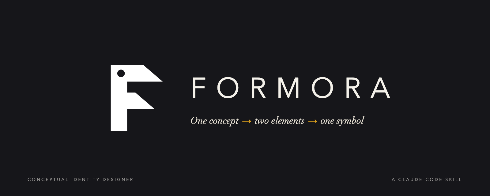
</p>

<p align="center">
  <a href="LICENSE">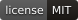</a>
  <a href="CHANGELOG.md"></a>
  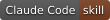
  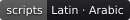
</p>

<h3 align="center">A conceptual identity designer for Claude Code.</h3>

<p align="center">
  FORMORA does not put an icon beside a word.<br>
  It finds the place where a letter <em>is</em> the animal, the object or the idea, and builds that as one mark.
</p>

---

## The idea in one line

> **One concept → Two visual elements → One unified symbol.**

Ask most tools for a wolf logo and you get a wolf next to the word WOLF. FORMORA asks a different question: *which
part of the W is already a wolf?* The outer strokes become ears, the centre becomes the muzzle, the eyes are cut
out of the letter. You read a W and see a wolf, in the same shape.

<table>
  <tr>
    <td width="50%">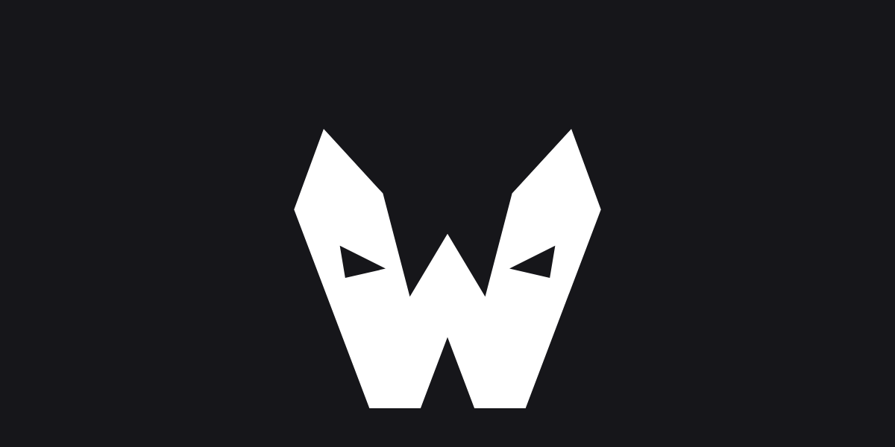</td>
    <td width="50%">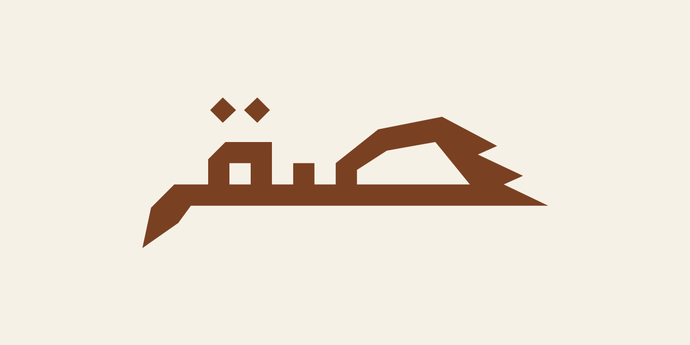</td>
  </tr>
  <tr>
    <td align="center"><strong>WOLF</strong> — the letter W is the wolf's head</td>
    <td align="center"><strong>صقر (Saqr, “falcon”)</strong> — the word is the bird</td>
  </tr>
</table>

Both marks above were produced by the skill as hand-built vector paths. They are in [`examples/`](examples).

## What it does

FORMORA is a skill: a set of instructions, reference guides and templates that Claude Code loads when you ask for
a logo. It takes a brief through nine steps.

| # | Step | What you get |
|---|------|--------------|
| 1 | **Brand intelligence** | A short brief, with every assumption marked as an assumption |
| 2 | **Concept discovery** | Five directions that use *different mechanisms*, not five variations of one |
| 3 | **Score and present** | Each direction scored out of 100, weak ones replaced, and a recommendation |
| 4 | **Construction brief** | Silhouette, key letterforms, how the parts join, negative space |
| 5 | **Visual exploration** | A ready image prompt, or monochrome sketches if you have an image tool |
| 6 | **Build the vector** | A real SVG made of paths, checked at 16 px, in one colour, on light and dark |
| 7 | **Refine** | Named faults fixed one at a time, re-checked after each |
| 8 | **Identity system** | Palette with computed contrast, type pairing, clear space, misuse rules, mockups |
| 9 | **Deliver** | A specification and a brand book that prints to PDF |

You stay in control throughout: ask for more concepts, reject one, combine two, change style and keep the idea.

## Seven ways to fuse

| Technique | In short |
|-----------|----------|
| **Letterform morphing** | Part of a letter becomes part of the subject |
| **Silhouette integration** | The whole word or letter takes the subject's outline |
| **Negative-space fusion** | The second subject lives in the gaps |
| **Shape fusion** | Two forms share one contour |
| **Typography illustration** | Letters are drawn as the thing they name |
| **Symbolic geometry** | Circles and lines carry the meaning |
| **Hidden letterforms** | A letter is concealed inside the symbol |

Full guidance, with worked briefs: [`conceptual-techniques.md`](skills/formora-logo-design/references/conceptual-techniques.md).

## How concepts are scored

Every direction is scored before any image is made. Anything that fails the rejection criteria is replaced.

| Criterion | Points |
|-----------|-------:|
| Conceptual intelligence | 20 |
| Visual integration | 20 |
| Brand relevance | 15 |
| Clarity and recognition | 15 |
| Memorability | 10 |
| Typography quality | 10 |
| Scalability and reproduction | 10 |
| **Total** | **100** |

## A brand book, not just a file

Step 9 fills a template that prints to an A4 landscape brand book. This one was made for the Saqr example.

<table>
  <tr>
    <td width="50%">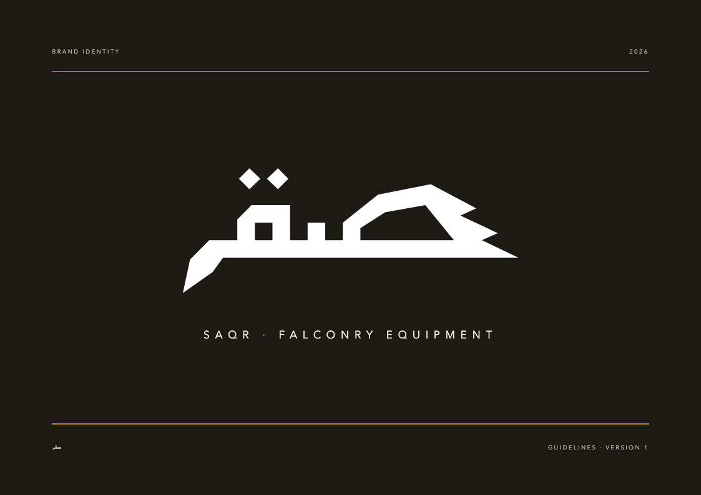</td>
    <td width="50%">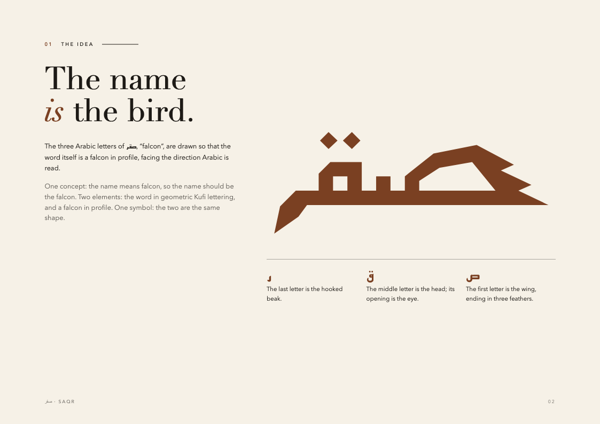</td>
  </tr>
  <tr>
    <td width="50%">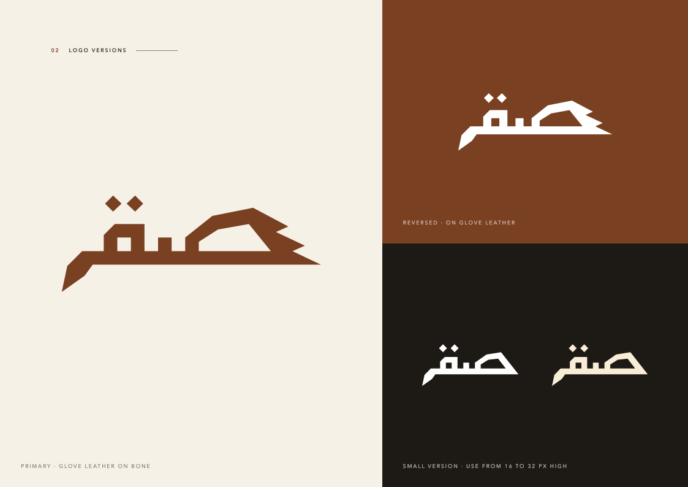</td>
    <td width="50%">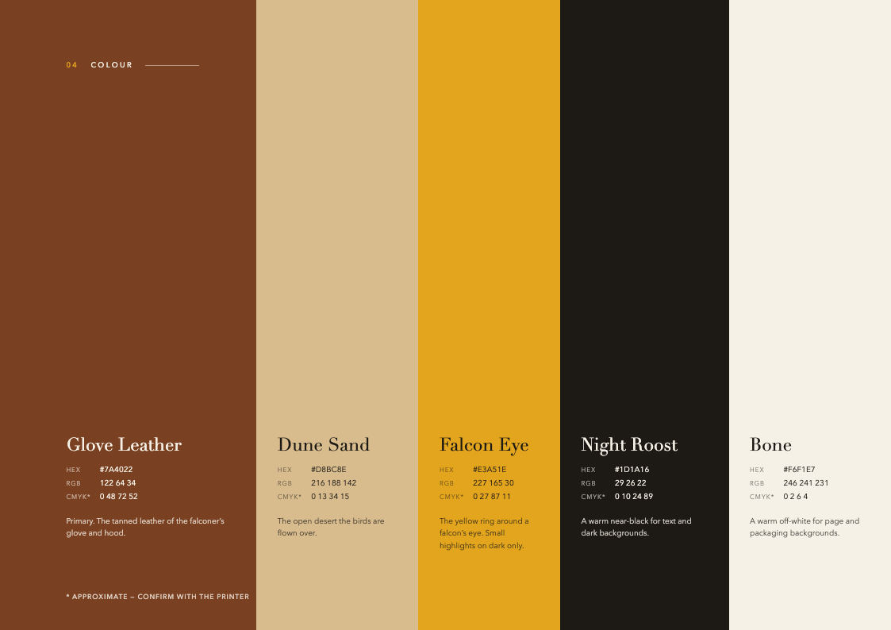</td>
  </tr>
</table>

Full PDFs: [English](examples/saqr/brand-presentation.pdf) ·
[Arabic, right-to-left](examples/brand-book/brand-book-arabic.pdf)

### Mockups that never redraw the logo

Image generators tend to redraw a logo, and they break Arabic lettering most of all. FORMORA's mockups place the
**real vector file** on a photograph by geometry only: perspective, blending, paper grain, shadow. The letters
cannot change. The tool is [`mockup.html`](skills/formora-logo-design/templates/mockup.html): you mark the four
corners of a surface, pick a finish (letterpress, stamped ink, raised lettering), and screenshot.

<table>
  <tr>
    <td width="50%">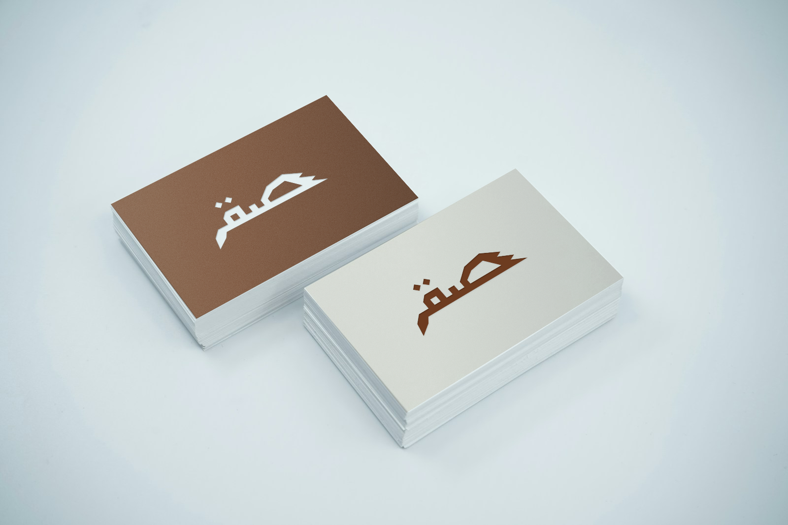</td>
    <td width="50%">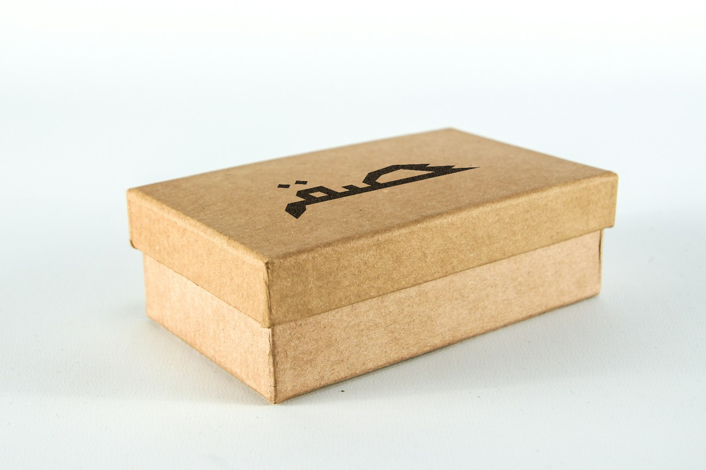</td>
  </tr>
</table>

## Arabic is designed on its own terms

A Latin construction cannot be transposed onto Arabic. Letters change shape by position, join into groups, and are
told apart by dots. FORMORA's [typography guide](skills/formora-logo-design/references/typography-guide.md) covers
contextual forms, dots, joining and non-joining letters, kashida, script styles (Kufi, Naskh, Thuluth, Diwani,
Ruq'ah), bilingual lockups, and one rule it will not skip:

> Show the mark to a native Arabic reader without telling them the name. They must read it correctly on their own.

## Honest by design

These are hard rules in the skill, not suggestions.

- Five scored concepts come **before** any image.
- Monochrome first. Colour only after the mark works in black and white.
- Brand facts are never invented. Assumptions are labelled.
- A generated image is a sketch. A raster image is never called a vector.
- A file is never described as made, exported or checked unless it was.
- Existing logos and references are never reproduced; only the technique is taken.
- CMYK values are labelled approximate until a printer confirms them.

## Install

FORMORA needs [Claude Code](https://claude.com/claude-code). No other software, accounts or keys.

```bash
git clone https://github.com/SunnysApartment/formora.git
```

```bash
mkdir -p ~/.claude/skills && cp -R formora/skills/formora-logo-design ~/.claude/skills/
```

That installs it for every project on your computer. To use it in one project only, copy the same folder into
that project's `.claude/skills/` instead. Start a new Claude Code session afterwards.

## Use

Type the command, or just describe what you want:

```text
/formora-logo-design Brand: WOLF. Outdoor equipment. Strength, exploration, resilience. Latin only.
```

```text
Design a logo where the letter K becomes a falcon in flight.
```

```text
صمّم شعارًا لكلمة «صقر» لمتجر معدات الصقارة، بالعربية فقط.
```

Useful follow-ups: *“show me five more directions”*, *“combine 2 and 4”*, *“make a simpler version for tiny
sizes”*, *“add colours and make the brand presentation”*, *“make the photographic mockups”*.

## What is in this repository

```text
formora/
├── skills/formora-logo-design/     the skill itself: copy this folder to install
│   ├── SKILL.md                    the workflow and hard rules (kept short)
│   ├── references/                 loaded only when a step needs them
│   │   ├── design-principles.md
│   │   ├── conceptual-techniques.md
│   │   ├── typography-guide.md     Latin, Arabic and bilingual
│   │   ├── quality-checklist.md    scoring, rejection, image and SVG review
│   │   ├── svg-construction.md     how to hand-build and validate the vector
│   │   ├── identity-system.md      colour, type, usage rules, mockups
│   │   └── reel-observations.md    the circle-and-line construction method
│   └── templates/
│       ├── concept-brief.md
│       ├── image-generation-prompt.md
│       ├── logo-specification.md
│       ├── preview.html            size, one-colour, light and dark check
│       ├── export-png.html         PNG copies of an SVG, transparent
│       ├── mockup.html             the real logo placed on a photo
│       └── brand-presentation.html the brand book (A4 landscape, prints to PDF)
├── examples/
│   ├── wolf/                       Latin symbol: brief and SVG files
│   ├── saqr/                       Arabic wordmark: brief, SVGs, palette, mockups, brand book
│   └── brand-book/                 the template filled in English and in Arabic
├── assets/                         FORMORA's own mark and the pictures in this readme
├── docs/SPEC.md                    the original specification
├── CHANGELOG.md
├── CONTRIBUTING.md
└── LICENSE
```

## The FORMORA mark

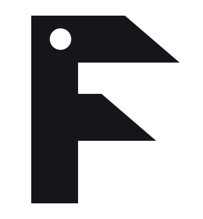

The mark was made with the skill's own method. **One concept:** a letter that becomes a creature. **Two
elements:** the F of FORMORA and a falcon's head. **One symbol:** the F's top arm ends in a hooked beak and the
eye is cut from the corner. The five directions considered and the construction are in
[`assets/logo/CONCEPT.md`](assets/logo/CONCEPT.md).

<br clear="left">

## Status and known limits

FORMORA is new. Read this before relying on it.

- **The Saqr lettering is not validated.** No native Arabic reader has read it yet, which the skill itself
  requires before approval. Treat the example as a demonstration, not an approved logo.
- **Tested only by its author's session.** Every example was produced in the session that built the skill. It has
  not been run on a new brief in a fresh session.
- **The brand book template** is tested with wide and square logos, in English and in Arabic right-to-left. It is
  untested with a light primary colour.
- **Fonts:** the brand book falls back to system fonts when the suggested typefaces are not installed.

## Roadmap

- [x] **1.0** — concept engine: five scored directions before any image
- [x] **1.1** — vector construction and the size-and-colour preview
- [x] **1.2** — identity system: palette, type, usage rules
- [x] **1.3** — mockups and the brand book
- [x] **1.4** — a ready-made mockup tool and PNG export tool
- [ ] **Next** — a light-colour brand book; a fresh-session test on a new brief
- [ ] **2.0** — similarity detection, design memory, a larger concept engine

Changes are recorded in the [changelog](CHANGELOG.md).

## Contributing

Native-reader checks, worked examples and corrections are all welcome. See [CONTRIBUTING.md](CONTRIBUTING.md).

## Credits

- Mockup photographs are from [Unsplash](https://unsplash.com) under the Unsplash licence. The photos themselves
  are not stored here; sources are listed in [`examples/saqr/mockups/SOURCES.md`](examples/saqr/mockups/SOURCES.md).
- The circle-and-line construction notes were drawn from publicly posted logo-process videos. No artwork from them
  is reproduced.
- Built with [Claude Code](https://claude.com/claude-code).

## License

[MIT](LICENSE). The example logos are demonstrations made for fictional briefs.
